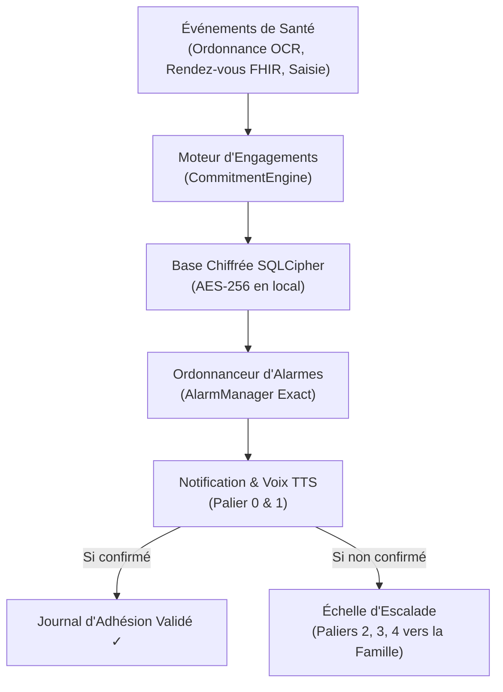
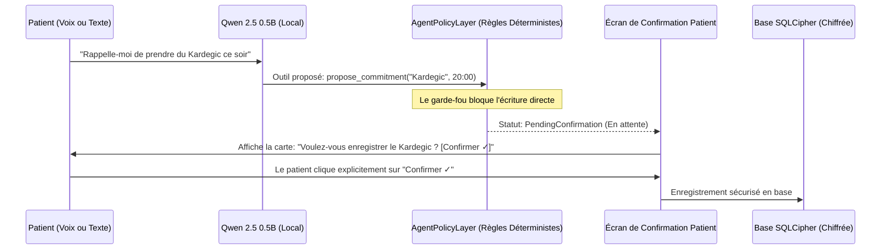

# CareLoop — Structure de l'Application et Guide des Fonctionnalités

> **Vision Fondatrice** : *"Doctolib vous amène chez le médecin. CareLoop s'assure que vous suivez le traitement, et prévient vos proches si ce n'est pas le cas."*

Ce document présente de façon simple et structurée **l'architecture globale**, **l'organisation des dossiers**, et **le fonctionnement détaillé** de chaque module de l'application CareLoop.

---

## 1. Vue d'Ensemble & Philosophie

CareLoop n'est pas une simple application de rappels de pilules : c'est un **agent d'engagement de santé autonome et offline-first** (qui fonctionne en priorité sans connexion Internet), pensé spécialement pour deux publics :
1. **Le patient âgé** : interface visuelle ultra-lisible (grands caractères, fort contraste), aucune manipulation complexe (pas de balayage caché, pas d'appui long), accès instantané même écran verrouillé.
2. **Les aidants familiaux (enfants, proches)** : rassurés par un journal d'activité transparent, alertés uniquement lorsque le patient n'a pas confirmé une prise critique, sans jamais divulguer de données médicales sensibles.



---

## 2. Structure des Dossiers du Projet

Voici l'organisation du code source dans `app/src/main/java/com/careloop/app/` :

```
com.careloop.app/
│
├── agent/                         # Cœur autonome de l'agent
│   ├── AlarmCapabilityNegotiator.kt # Négocie les permissions d'alarmes exactes (Android 14+)
│   ├── CommitmentEngine.kt         # Machine à états des engagements (Upcoming -> Due -> Completed)
│   ├── ConnectivityMonitor.kt      # Détecte l'accès Internet réel (différent de la simple connexion Wi-Fi)
│   ├── EscalationLadderManager.kt  # Exécute l'escalade vers les proches (Paliers 0 à 4)
│   ├── EscalationScheduler.kt      # Calcule les horaires précis des rappels (T, T+15m, T+30m, T+45m)
│   │
│   ├── llm/                        # Intelligence Artificielle Embarquée (Sur le téléphone)
│   │   └── CareLoopAgentEngine.kt  # Pilote Qwen 2.5 0.5B (Génération de prompts ChatML et extraction d'outils)
│   │
│   ├── policy/                     # Garde-fou de sécurité ("Rules Decide, an LLM Proposes")
│   │   ├── AgentTool.kt            # Contrats des outils typés (mark_taken, snooze, propose_commitment, etc.)
│   │   └── AgentPolicyLayer.kt     # Valide chaque action de l'IA avant toute écriture en base
│   │
│   └── worker/                     # Tâches périodiques en arrière-plan
│       └── Workers.kt              # VerificationWorker : réconcilie les rendez-vous avec le dossier médical
│
├── data/                          # Gestion des données locales
│   ├── local/
│   │   ├── CareLoopDatabase.kt     # Base Room chiffrée avec SQLCipher (AES-256)
│   │   ├── SecurityKeyManager.kt   # Gestion de la clé de chiffrement via Android Keystore
│   │   ├── dao/Daos.kt             # Requêtes SQL (CommitmentDao, CaregiverDao, AdherenceLogDao, etc.)
│   │   └── entity/Entities.kt      # Tables SQLite (patients, medications, commitments, adherence_logs...)
│   │
│   ├── repository/                 # Couche d'accès aux données métier
│   │   ├── CommitmentRepository.kt # Gestion des engagements et du journal d'adhésion
│   │   └── CaregiverRepository.kt  # Gestion des aidants et de leur rang de priorité
│   │
│   └── source/                     # Sources de données
│       └── HealthEventSources.kt   # MockFhirSource (Mon espace santé), ManualEntrySource, OcrPrescriptionSource
│
├── domain/                        # Modèles et interfaces métier purs
│   ├── model/                      # Commitment, Caregiver, EscalationTier, VerificationMethod, etc.
│   └── escalation/                 # EscalationChannel, DemoSmsChannel (SMS natif), PlaySmsChannel (Intent)
│
├── feature/ocr/                   # Scanner d'ordonnances médicales
│   └── PrescriptionOcrParser.kt    # Analyse le texte OCR (ML Kit), extrait posologie, force et médicament
│
├── service/                       # Services techniques Android
│   ├── CareLoopNotificationService.kt # Affiche les notifications système grand format avec boutons d'action
│   ├── TextToSpeechManager.kt      # Lit les rappels à voix haute en français (synthèse vocale)
│   ├── BackendEscalationClient.kt  # Client HTTP Ktor pour contacter le relais Twilio
│   └── FcmRelayClient.kt           # Client HTTP Ktor pour envoyer les notifications push aux proches
│
├── ui/                            # Interface Utilisateur Jetpack Compose
│   ├── MainActivity.kt             # Point d'entrée de l'application
│   ├── QuickCheckerActivity.kt     # Écran géant d'urgence (Triple-tap / Écran verrouillé)
│   │
│   ├── navigation/                 # Navigation entre écrans
│   │   ├── Screen.kt               # Liste des routes de navigation
│   │   └── CareLoopNavGraph.kt     # Graphe de navigation Compose
│   │
│   ├── screens/                    # Les écrans de l'application
│   │   ├── TodayTimelineScreen.kt      # Écran principal : calendrier et prises du jour
│   │   ├── AssistantScreen.kt          # Conversation avec l'Agent IA (Qwen) + cartes de confirmation
│   │   ├── CommitmentDetailScreen.kt   # Détail d'un médicament ou rendez-vous
│   │   ├── ManualEntryScreen.kt        # Formulaire simple d'ajout manuel
│   │   ├── OcrPrescriptionScreen.kt    # Écran de validation de l'ordonnance scannée
│   │   ├── CaregiverSetupScreen.kt     # Configuration des proches, consentements et code d'appairage
│   │   ├── CaregiverCompanionScreen.kt # Écran simplifié dédié à l'aidant familial
│   │   ├── CaregiverTimelineScreen.kt  # Historique immuable des alertes envoyées
│   │   ├── PharmacyFinderScreen.kt     # Trouver les pharmacies ouvertes à proximité (OpenStreetMap)
│   │   ├── DemoModeScreen.kt           # Accélérateur temporel pour les jurys de hackathon
│   │   └── SettingsScreen.kt           # Paramètres, disclaimer médical, export et suppression RGPD
│   │
│   ├── components/                 # Boutons géants, cartes d'engagements, bannières
│   ├── gesture/MultiTapGestureModifier.kt # Détecteur du triple-tap n'importe où sur l'écran
│   └── theme/Theme.kt              # Palette accessible WCAG AAA (contrastes élevés, grande typographie)
│
backend/                           # Micro-service Node.js d'escalade
├── escalation_service.js           # Relais sans état pour SMS et appels téléphoniques Twilio
├── package.json                    # Dépendances du backend
├── Dockerfile                      # Déploiement conteneurisé
├── README.md                       # Guide de conformité HDS et RGPD
└── test/escalation_service.test.js # Tests automatisés du backend
```

---

## 3. Détail des Grandes Fonctionnalités

### 1. Le Suivi des Engagements de Santé (Cycle de Vie)
Contrairement à une simple alarme qui s'éteint, chaque prise de médicament ou rendez-vous est un **engagement** régi par une machine à états stricte :
- `UPCOMING` (À venir) : L'heure n'est pas encore arrivée.
- `DUE` (À prendre maintenant) : L'alarme exacte sonne, la notification apparaît avec les boutons "Pris ✓" et "Reporter".
- `COMPLETED` (Validé) : Le patient a confirmé la prise, ou le dossier médical (FHIR) a validé le rendez-vous.
- `MISSED` (Manqué) : L'heure est dépassée de plus de 15 minutes sans confirmation.
- `ESCALATED` (En cours d'escalade) : Les alertes vers les proches sont déclenchées étape par étape.
- `SNOOZED` (Reporté) : Repousse le rappel (entre 5 et 120 minutes), puis revient à `DUE`.

---

### 2. L'Accès Instantané "Zéro-Friction" pour les Seniors
Les personnes âgées ont souvent du mal à déverrouiller un téléphone ou à taper un code. CareLoop propose 3 raccourcis immédiats :
1. **Le Triple-Tap Universel** : En tapotant 3 fois n'importe où sur l'écran, l'écran géant de validation (`QuickCheckerActivity`) s'ouvre immédiatement.
2. **Validation Écran Verrouillé** : Cette interface peut s'allumer et s'afficher **même si le téléphone est verrouillé** (`showWhenLocked="true"`). Un bouton géant de 130dp affiche : **"OUI, J'AI PRIS MON MÉDICAMENT ✓"**.
3. **Tuile dans la barre de notifications (Quick Settings Tile)** : En glissant le doigt du haut vers le bas, une tuile "CareLoop" permet de valider d'un simple toucher.

---

### 3. L'Échelle d'Escalade Progressive (Paliers 0 à 4)

Lorsque le patient ne répond pas, CareLoop applique une montée en puissance progressive :

| Palier | Quand ? | Action réalisée | Fonctionne Hors-Ligne ? |
| :---: | :---: | :--- | :---: |
| **Palier 0** | À l'heure $T$ | **Notification prioritaire locale** avec sonnerie et boutons d'action ("Pris" / "Reporter"). | **OUI** |
| **Palier 1** | $T + 15$ min | **Rappel vocal TTS** : Le téléphone parle à voix haute pour rappeler l'importance de la prise. | **OUI** |
| **Palier 2** | $T + 30$ min | **Notification Push à l'aidant** : Envoi d'une alerte discrète sur l'app compagnon du proche (via FCM). | Non (Nécessite Internet) |
| **Palier 3** | $T + 45$ min | **Appel vocal ou SMS Twilio** : Le serveur appelle directement le téléphone de l'aidant avec un message vocal en français. | Non (Nécessite Internet) |
| **Palier 4** | Repli | **SMS cellulaire direct (GSM)** : Si le téléphone est hors-ligne, un SMS est envoyé directement par la carte SIM du téléphone via le réseau mobile natif. | **OUI (100% autonome)** |

> [!IMPORTANT]
> **Règle absolue de Minimisation des Données (RGPD)** :
> Aucun message envoyé aux proches ou aux réseaux télécoms ne contient de nom de médicament ou de maladie. Le message est toujours minimisé :
> *"CareLoop : [Nom du patient] n'a pas confirmé un rappel important. Merci de prendre de ses nouvelles."*

---

### 4. L'IA Embarquée (Qwen 2.5 0.5B) & Le Garde-Fou Médical

CareLoop intègre le modèle de langage **Qwen 2.5 0.5B Instruct (Mobile INT4)** directement dans le fichier APK (`app/src/main/assets/models/qwen2.5-0.5b-instruct-int4.bin`, 469 Mo).

#### Le Principe Non-Négociable : "Rules decide, an LLM proposes"
L'IA ne prend **jamais** de décision autonome sur la santé du patient. Elle sert uniquement de traducteur entre la voix du patient et les commandes de l'application :



- **Refus des questions de diagnostic** : Si le patient demande *"Est-ce que je peux doubler ma dose ?"*, l'IA répond automatiquement : *"Je ne peux pas donner de conseil médical. Veuillez contacter votre médecin ou votre pharmacien."*
- **Fonctionnement garanti sans IA** : Si l'appareil a peu de mémoire vive, le moteur bascule sur un analyseur de règles déterministe sans jamais faire planter l'application.

---

### 5. Le Scanner d'Ordonnances (OCR + Dictionnaire)
- L'utilisateur prend en photo son ordonnance avec **CameraX**.
- **Google ML Kit Text Recognition v2** extrait le texte en local sur le processeur du téléphone.
- Le parseur recherche la correspondance dans un **dictionnaire de médicaments** (Kardegic, Doliprane, etc.) et extrait la force (`75mg`) et la forme (`sachet`).
- **Écran de révision obligatoire (`OcrPrescriptionScreen`)** : Les champs sont pré-remplis en grand format. Rien n'est enregistré tant que le patient n'a pas relu et appuyé sur "Confirmer & Enregistrer ✓".

---

### 6. La Vérification avec *Mon espace santé* (DMP FHIR)
- Doctolib ne possédant aucune API publique pour les patients, CareLoop utilise le standard officiel français du **Ségur du Numérique** : les API FHIR du **Dossier Médical Partagé (DMP)**.
- En démonstration, un composant `MockFhirSource` simule les retours de consultations médicales et de délivrance en pharmacie.
- Le composant `VerificationWorker` tourne en tâche de fond et valide automatiquement les engagements avec le badge vert : **"Vérifié depuis le dossier médical ✓"**.

---

### 7. L'Espace Aidant Familial & Appairage
- L'aidant est enregistré avec un rang de priorité (Rang 1 = contact principal, Rang 2 = second contact).
- L'application enregistre le **consentement RGPD explicite** avec horodatage.
- Un **code d'appairage à 8 caractères** (ex: `PAIR-A1B2C3D4`) permet de relier le téléphone de l'aidant sans avoir besoin de créer un compte avec mot de passe.
- L'écran **Caregiver Timeline** offre un historique immuable et infalsifiable de toutes les notifications et alertes émises.

---

## 4. Les Deux Versions de l'Application (Build Flavors)

Pour concilier la démonstration lors du hackathon et la conformité stricte pour une publication sur les stores :

1. **Flavor `demo`** : 
   - Destinée à l'installation directe (sideloading APK).
   - Utilise l'autorisation Android `SEND_SMS` pour envoyer silencieusement un SMS depuis la carte SIM du téléphone vers le proche en cas de Palier 4 (repli hors-ligne).
2. **Flavor `play`** : 
   - Conforme à 100% avec les règles de Google Play Store.
   - Ne demande pas l'autorisation restreinte `SEND_SMS`. Elle pré-remplit l'application SMS du téléphone (`Intent.ACTION_SENDTO`) en laissant le patient valider en 1 touche.

---

## 5. Synthèse des Commandes Utiles

| Action | Commande |
| :--- | :--- |
| **Lancer tous les tests unitaires (32 tests)** | `./gradlew testDemoDebugUnitTest testPlayDebugUnitTest` |
| **Compiler l'APK Démo autonome (IA incluse)** | `./gradlew assembleDemoDebug` |
| **Compiler l'APK Play Store** | `./gradlew assemblePlayDebug` |
| **Lancer les tests du backend Node.js (5 tests)** | `cd backend && npm test` |
| **Démarrer le backend d'escalade Twilio** | `cd backend && npm start` |
| **Télécharger les poids du modèle Qwen 2.5** | `./scripts/download_qwen_weights.sh` |

